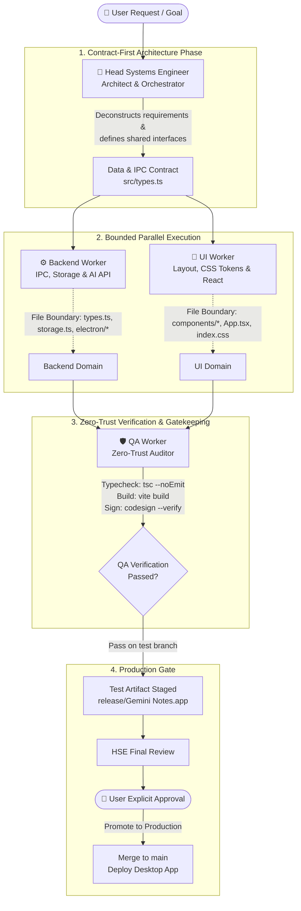

# The Head Systems Engineer Architecture
### A Comprehensive Engineering Guide to Multi-Agent Software Development in Antigravity

---

## 1. Executive Summary & Core Philosophy

When building complex software with Artificial Intelligence, traditional single-agent approaches quickly degrade. A single AI agent tasked with writing backend IPC, styling multi-column CSS layouts, refactoring state stores, and verifying build artifacts inevitably suffers from **context window pollution**, **hallucinated multi-tasking**, **scope creep**, and **silent regressions**.

The **Head Systems Engineer Pattern** solves this by establishing a disciplined, hierarchical **Tri-Agent Orchestrator Model**. 

Instead of one agent attempting to do everything:
1. **The Head Systems Engineer (Orchestrator)** acts as the engineering director and systems architect. It ingests ambiguous user requirements, breaks them into strictly isolated technical contracts, delegates tasks to specialized subagents, and enforces release criteria.
2. **Specialized Workers** operate in parallel within strictly bounded domains:
   - **Backend Systems Engineer (`backend-worker`)**: Owns schemas, storage engines, IPC bridges, and third-party API resilience.
   - **Principal UI & Design Engineer (`ui-worker`)**: Owns design tokens, responsive layouts, DOM manipulation, component hierarchies, and user interactions.
   - **Lead QA & Verification Engineer (`qa-worker`)**: Operates on a **Zero-Trust** mandate. It audits type safety, bundle compilation, OS code signing, regression testing, and release branch gating.



---

## 2. Direct Interviews: Firsthand Accounts from the Workers

To understand how this architecture functions in practice, each worker was independently interviewed regarding their role, scope, workflows, and edge cases in the **Gemini Notes** desktop application codebase.

---

### Worker 1: The Backend Systems Engineer (`backend-worker`)

> *"My guiding philosophy is that UI is ephemeral, but data integrity and system IPC are forever."*

#### 1. Scope & Ownership
- **Primary Domain**: Data schemas, local persistence, Electron IPC bridges, operating system integration, and external API orchestration.
- **Strict File Boundaries**:
  - `src/types.ts` (Data contracts & interfaces)
  - `src/services/storage.ts` (Local data storage & state hydration)
  - `src/services/gemini.ts` (Gemini API integration & model fallbacks)
  - `electron/main.cjs` & `electron/preload.cjs` (Process isolation, native menus, window state)

#### 2. Workflow & Process
1. **Contract Definition**: When a new feature is requested, work begins in `src/types.ts`. All data models, actions, and payload types are defined with explicit TypeScript interfaces before any consumer code is touched.
2. **Defensive Storage Engine**: Every data store must support backward-compatible hydration. If a user has existing notes from an older schema version, migrations and default fallback assignments ensure the app never crashes on launch.
3. **Secure IPC Bridge**: All Electron operations adhere to the principle of least privilege. Node APIs are never exposed directly to the renderer. Context isolation is enforced via `contextBridge.exposeInMainWorld`.
4. **Resilient AI Pipeline**: Implements 3-tier fallback logic for Gemini APIs:
   - Primary: `gemini-3-flash-preview`
   - Secondary: Regex extraction of server-suggested models via `matchAll`
   - Tertiary: Dynamic fallback via `v1beta/models` (`ListModels`) discovery.

#### 3. Real-World Case Study: Theme Persistence & Date Bucketing
When Apple Notes-style organization was introduced:
- **Backend Worker** updated `src/types.ts` to support `ThemeMode ('light' | 'dark' | 'system')`, `AccentColor`, and `DateBucket ('Today' | 'Yesterday' | 'Previous 7 Days' | 'Previous 30 Days' | Month)`.
- It built the date bucket computation logic in `src/services/storage.ts` so the UI received pre-categorized, predictable data arrays without having to perform expensive O(N) date math on every re-render.

---

### Worker 2: The Principal UI & Design Engineer (`ui-worker`)

> *"My mission is to translate data contracts into tactile, accessible, and high-performance user interfaces without ever touching backend plumbing."*

#### 1. Scope & Ownership
- **Primary Domain**: Component hierarchy, CSS token design systems, responsive multi-column layouts, animations, and rich-text DOM interactions.
- **Strict File Boundaries**:
  - `src/App.tsx` (Top-level view orchestration)
  - `src/index.css` (CSS variables, design tokens, typography, Apple Notes aesthetics)
  - `src/components/*` (`Sidebar.tsx`, `NoteList.tsx`, `Editor.tsx`, `AiAssistModal.tsx`, `SettingsModal.tsx`)

#### 2. Workflow & Process
1. **Design Token Hierarchy**: All styling is built on CSS custom properties anchored to `data-theme` and `data-accent` attributes on the root element. Hardcoded hex colors are prohibited.
2. **Layout Architecture**: Built a multi-pane responsive layout mimicking macOS Apple Notes:
   - 3-column default view (Folders / Tag Sidebar -> Note List with date bucket headers -> Editor Pane).
   - Collapsible panels with keyboard shortcuts (`Cmd+\` or toolbar toggles).
3. **DOM Range Preservation**: For AI text insertion and formatting, standard React `state` binding can cause caret jumping. The UI worker utilizes DOM `Selection` and `Range` cloning to insert AI-generated text directly at the user's cursor position without triggering destructive re-renders.
4. **Focus Mode (Zen Mode)**: Allows the user to hide navigation sidebars and focus purely on writing.

#### 3. Real-World Case Study: The Window Traffic Light Overlap Bug
When users switched to Zen Focus Mode on macOS, the traffic light window controls (close/minimize/maximize) overlapped the document title bar because the sidebar had collapsed to 0px.
- **UI Worker** resolved this with precision CSS:
  ```css
  /* Window traffic light avoidance in full focus mode */
  .focus-mode-topbar {
    padding-left: 88px;
    transition: padding-left 0.2s cubic-bezier(0.16, 1, 0.3, 1);
  }
  ```
Because file boundaries were strictly enforced, the UI worker resolved this visual layout bug without risking any regressions to the note save logic or Electron IPC.

---

### Worker 3: The Lead QA & Verification Engineer (`qa-worker`)

> *"My job is Zero-Trust. I trust no code until the compiler, linter, test runner, code signer, and OS runtime verify it."*

#### 1. Scope & Ownership
- **Primary Domain**: Static analysis, bundle compilation, macOS code signing integrity, release packaging, production gating, and end-user documentation.
- **Strict Boundaries**:
  - Does NOT author features or modify application business logic.
  - Owns test execution, build scripts (`npm run build`, `npm run package:mac`), signature verification (`codesign -vvv --deep --strict`), and release gate enforcement (`GEMINI.md`).

#### 2. Workflow & Process
1. **Compilation & Type Gate**: Executes `npx tsc --noEmit` and `npm run build`. Any TypeScript type mismatch or Vite packaging error fails the pipeline immediately.
2. **macOS Gatekeeper & Code Signing Auditing**: macOS Desktop environments often suffer from hidden iCloud extended attributes (`com.apple.FinderInfo`, `com.apple.quarantine`), which instantly invalidate Mach-O binary signatures. The QA worker enforces a 3-step staging workflow:
   ```bash
   # 1. Strip all macOS metadata detritus
   xattr -cr "/tmp/Gemini Notes.app"
   
   # 2. Deep sign with ad-hoc identity
   codesign --force --deep --sign - "/tmp/Gemini Notes.app"
   
   # 3. Transfer cleanly without resource forks
   ditto --norsrc "/tmp/Gemini Notes.app" "release/Gemini Notes.app"
   ```
3. **Production Gatekeeper**: Strictly enforces rule #1 of `GEMINI.md`:
   - Work is committed and tested on the `test` branch first.
   - Code is **never** pushed to `main` or deployed to `/Users/vincentmoses/Desktop/Gemini Notes.app` without explicit user sign-off.

---

## 3. The Orchestration Protocol: How the Head Systems Engineer Coordinates

The Head Systems Engineer functions as the **Central Brain**. It does not write all the code itself; it ensures the right worker writes the right code at the right time.

### 1. Requirements Deconstruction
When a prompt arrives (e.g., *"Make it look like Apple Notes with custom themes and ensure it doesn't crash when resizing"*), the HSE deconstructs it into three parallel work orders:

| Workstream | Assigned Worker | Required Contract Output |
| :--- | :--- | :--- |
| **Data Schema & State** | `backend-worker` | `ThemeMode`, `AccentColor` types and safe local storage hydration. |
| **Visual Architecture** | `ui-worker` | CSS token variables, 3-column flex layout, traffic-light safe paddings. |
| **Verification & Gate** | `qa-worker` | Static type checks, bundle compilation, bundle signing, clean staging. |

### 2. Contract-First Dependency Handoff
To prevent race conditions, the HSE enforces sequencing:
1. `backend-worker` completes `src/types.ts`.
2. `ui-worker` implements the components using the newly compiled interfaces.
3. `qa-worker` audits the combined output.

### 3. Non-Polling Reactive Wakeup
In Antigravity, subagents execute asynchronously. The HSE does not waste cycles in a busy polling loop. The runtime triggers an automatic reactive wakeup when a subagent finishes and posts its report via `send_message`.

---

## 4. Key Engineering Benefits

1. **Elimination of Context Degradation**: Each subagent's context window contains only the code and instructions relevant to its domain. The UI engineer doesn't have its context cluttered with Electron IPC protocols, and the Backend engineer doesn't have its context filled with CSS flexbox rules.
2. **Zero-Trust Safety**: Developers often suffer from confirmation bias when testing their own code. By separating QA into an autonomous persona that actively attempts to break builds and check for signature corruption, bugs are caught before reaching the user.
3. **Clean Git Lineage**: The separation between `test` and `main` branches ensures that unstable or experimental code is thoroughly staged and vetted before production deployment.

---

## 5. Summary Reference Card for Your Friend

If your friend wants to set up a similar multi-agent system, share these three golden rules:

> ### The 3 Laws of Multi-Agent Systems Engineering:
> 1. **Establish Rigid File Boundaries**: Two agents should never have write permission to the same file in the same cycle. Split types, logic, and views cleanly.
> 2. **Contracts Precede Implementation**: Always write and commit data schemas (`types.ts`) before writing consumer code.
> 3. **Separate Creation from Verification**: Never let the agent that wrote the feature declare that it is ready for production. Delegate verification to a Zero-Trust QA agent.
